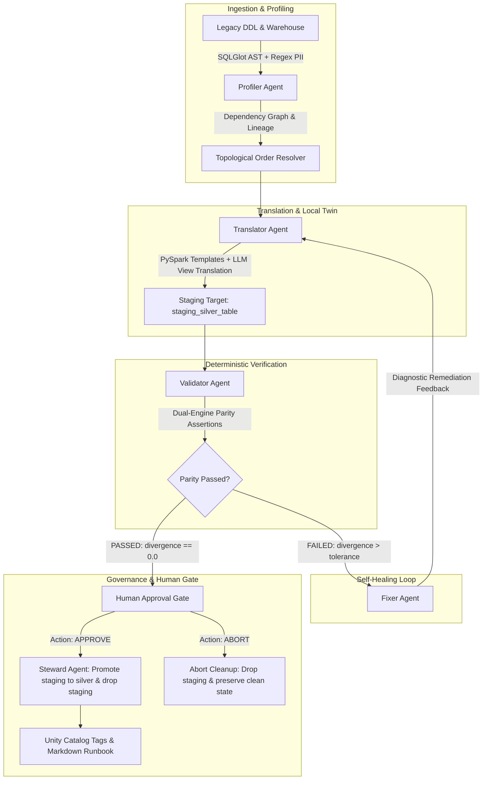

# Legacy-to-Lakehouse Migration Copilot

[](https://opensource.org/licenses/Apache-2.0)
[](https://python.org)
[](https://langchain-ai.github.io/langgraph/)
[](https://fastapi.tiangolo.com)
[](https://react.dev)
[](https://duckdb.org)
[](https://databricks.com)
[](https://delta.io)

An autonomous, self-healing multi-agent engineering copilot orchestrated with **LangGraph**. It ingests legacy data warehouse DDL and stored procedures (Oracle / Netezza / legacy SQL), translates them into modern **Databricks PySpark Medallion architectures** (Bronze / Silver), verifies migration fidelity via **deterministic dual-engine parity gates** (local DuckDB twin vs. Databricks), self-heals translation flaws through closed-loop diagnosis, enforces **fail-closed staging isolation**, and provides a purpose-built **Operator Console Web UI** for human-in-the-loop review and promotion.

---

## 🎯 The Core Philosophy: "Evidence, Not Reassurance"

Most LLM migration demos ask an LLM to "grade its own work" or generate simple code templates that pass on happy-path data. In real-world enterprise migrations, that approach produces silent data corruption.

This copilot takes a strictly engineering-first approach:
1. **Deterministic Dual-Engine Twin**: Instead of trusting LLM self-evaluation, the system validates translations by executing queries against an isolated database twin (DuckDB locally, Databricks in cloud) and computing exact mathematical parity:
   - Row cardinality balance
   - Duplicate primary key index parity
   - Numeric epsilon variance ($\le 10^{-6}$) across floating/decimal currency columns
   - Null-distribution invariance
2. **Active Self-Healing Repair Loop**: Naive translations fail when encountering seeded legacy antipatterns (timestamp-tied duplicate records, float currency drift, empty-string vs null confusion). The **Fixer** agent diagnoses the exact failure category and triggers an iterative repair pass with the **Translator** until strict mathematical parity is reached.
3. **Fail-Closed Staging Isolation**: Translations never write directly to production tables. Writes are quarantined in `staging_silver_{table}`. The execution halts at a **Human Approval Gate**. Only an explicit operator approval promotes staging to production `silver_{table}`; an abort command purges staging and leaves production untouched.
4. **Keyed Salted PII Protection**: 11-digit national IDs (CPF), emails, and phone numbers are redacted using keyed cryptographic hashing (`SHA-256(col || salt)`), resisting rainbow table precomputation.
5. **Topological Multi-Entity DAG Pipeline**: Resolves table foreign-key hierarchies and traverses the catalog in dependency order (`--all`).
6. **Local LLM First**: Fully operational with local open-weights models via **Ollama** (`llama3.2`, `qwen`, `granite`) with offline mock model fallbacks for continuous integration.
7. **Operator Console Web UI**: A cyber-industrial, high-density React/TypeScript web console backed by FastAPI and SSE event streaming, built strictly to the [ui-2.md](file:///d:/coding/github/legacy-to-lakehouse-copilot/docs/ui/demo/ui-2.md) specification.

---

## 🏗️ Multi-Agent Architecture



---

## 📂 Codebase Directory Layout

```
legacy-to-lakehouse-copilot/
├── configs/
│   └── settings.yaml           # Dialect mapping, retry thresholds, DB paths, security
├── data/
│   ├── legacy/                 # Source legacy warehouse (DuckDB / synthetic Olist)
│   └── medallion/              # Lakehouse medallion storage (DuckDB local twin / Delta)
├── docs/
│   ├── plan/initial-plan.md    # Original architectural specification
│   ├── runbooks/               # Auto-generated Steward migration runbooks
│   ├── state/                  # Milestone state archives & architectural logs
│   ├── ui/demo/                # UI design specifications (ui-1.md, ui-2.md, demo-1.html)
│   └── test.md                 # Hands-on test guide & verification playbook
├── src/
│   ├── agents/
│   │   ├── profiler.py         # AST parser, PII detection, topological ordering
│   │   ├── translator.py       # Medallion PySpark generator & staging DuckDB translator
│   │   ├── validator.py        # Parity engine (cardinality, duplicates, epsilon, nulls)
│   │   ├── fixer.py            # Error categorization & diagnostic feedback generator
│   │   └── steward.py          # Staging promotion, Unity Catalog tags, Markdown runbook
│   ├── api/
│   │   ├── app.py              # FastAPI application & static web distributor
│   │   ├── routes.py           # REST endpoints (/api/runs, /api/threads, /api/fixtures)
│   │   └── runner.py           # Asynchronous execution manager & SSE event streamer
│   ├── core/
│   │   ├── checkpointer.py     # SQLite checkpointer (SqliteSaver) for pause/resume
│   │   ├── graph.py            # Compiled LangGraph StateGraph with interrupt gates
│   │   └── state.py            # TypedDict state contracts (MigrationState, ColumnProfile)
│   ├── llm/
│   │   └── factory.py          # Swappable LLM provider factory (Ollama, MockChatModel)
│   ├── tools/
│   │   ├── database.py         # DuckDB / database runner abstraction
│   │   ├── harness.py          # Legacy warehouse test harness with seeded antipatterns
│   │   └── metrics.py          # Deterministic reconciliation queries & metric calculators
│   ├── cli.py                  # CLI entrypoint (seed, run, resume, serve)
│   └── config.py               # Pydantic settings with .env override precedence
├── tests/
│   ├── fixtures/               # Offline state snapshots (passed, mid_repair, failed_closed)
│   ├── test_api.py             # FastAPI REST endpoint & fixture tests
│   ├── test_dag_pipeline.py    # Multi-table topological DAG execution test
│   ├── test_fixer.py           # Fixer diagnostic report test
│   ├── test_graph_e2e.py       # End-to-end graph execution with HITL breakpoint test
│   ├── test_harness.py         # Seeded warehouse antipatterns test
│   ├── test_metrics.py         # Deterministic metric assertion test
│   ├── test_pii_salted_hash.py # Salted cryptographic PII hashing test
│   ├── test_profiler.py        # Profiler AST & lineage test
│   ├── test_repair_loop_benchmark.py # Float drift & duplicate tie repair loop benchmark
│   ├── test_staging_promotion.py     # Staging schema isolation & abort cleanup test
│   ├── test_translator.py      # PySpark & DuckDB artifact generation test
│   └── test_validator.py       # Dual-engine parity validation test
├── web/                        # Operator Console Frontend (React + TypeScript + Vite)
│   ├── dist/                   # Production-compiled static frontend assets
│   ├── src/                    # Components (MigrationBoard, TableReview, Header)
│   ├── package.json            # Vite, React, Lucide, Oxlint dependencies
│   └── vite.config.ts          # Vite build & proxy configuration
├── .env.example                # Sample environment variables
├── pyproject.toml              # Build system & pytest configuration
├── requirements.txt            # Python dependencies
└── README.md                   # Project overview & documentation
```

---

## ⚡ Quick Start

### 1. Prerequisites
- **Python**: 3.11+ (tested on Python 3.13)
- **Node.js**: v18+ (for frontend development in `web/`)
- **Ollama**: (Optional for local LLM inference) with model `llama3.2:latest`:
  ```bash
  ollama run llama3.2:latest
  ```

### 2. Environment Setup
Create and activate a virtual environment, then install dependencies:
```powershell
python -m venv .venv
.\.venv\Scripts\Activate.ps1
pip install -r requirements.txt
```

Copy the environment file and set your cryptographic salt:
```powershell
cp .env.example .env
```

Ensure `.env` contains:
```ini
LLM_PROVIDER=ollama
OLLAMA_BASE_URL=http://localhost:11434
OLLAMA_MODEL=llama3.2:latest
PII_HASH_SALT=copilot_production_salt_99
```
*(If Ollama is not running, the system automatically falls back to offline deterministic mock models).*

---

## 🚀 Running the System

### Option A: Web Operator Console (Recommended)
Launch the unified FastAPI server and web interface:
```powershell
.\.venv\Scripts\python.exe -m src.cli serve --host 127.0.0.1 --port 8000
```
Open your browser to: **[http://127.0.0.1:8000](http://127.0.0.1:8000)**

The Web Console provides:
- **Migration Board**: Visualizes topological table status, check counts, attempt counts, and PII badges.
- **Table Review**: Segmented checks bar, side-by-side Schema & PII masking preview, generated PySpark code, repair attempt diffs, live trace, and Decision Rail (Approve, Request Changes, Abort).
- **Test Fixtures**: Quick inspection of `passed`, `mid_repair`, and `failed_closed` scenarios.

### Option B: Command Line Interface (CLI)

#### 1. Seed the Legacy Warehouse
Generate synthetic legacy warehouse tables containing real-world antipatterns:
```powershell
.\.venv\Scripts\python.exe -m src.cli seed
```

#### 2. Run Migration on a Single Table (Watch the Self-Healing Loop)
```powershell
.\.venv\Scripts\python.exe -m src.cli run --table raw_orders
```
**What happens:**
1. Pass 0 fails deterministic validation due to duplicate order timestamps.
2. The Fixer diagnoses cardinality divergence.
3. Translator executes Pass 1 with window deduplication tie-breakers.
4. Validation passes (`0.0` divergence).
5. Execution pauses at the **Human Approval Gate** for `staging_silver_raw_orders`.

#### 3. Resume with Human Action
**To approve and promote:**
```powershell
.\.venv\Scripts\python.exe -m src.cli resume --thread-id <THREAD_ID> --action approve
```
*Promotes `staging_silver_raw_orders` to `silver_raw_orders`, drops the staging table, and writes the Steward runbook.*

**To abort and clean staging:**
```powershell
.\.venv\Scripts\python.exe -m src.cli resume --thread-id <THREAD_ID> --action abort
```
*Drops `staging_silver_raw_orders` and leaves production untouched.*

#### 4. Run Full Catalog Topological Migration
Migrate all warehouse tables in dependency order:
```powershell
.\.venv\Scripts\python.exe -m src.cli run --all
```

---

## 🧪 Testing & Verification

Run the full automated test suite (19 tests covering unit, integration, benchmark, API, DAG, security, and staging):
```powershell
.\.venv\Scripts\pytest -v tests/
```

For hands-on testing scenarios, step-by-step verification flows, and UI evaluation, see the complete guide in [docs/test.md](file:///d:/coding/github/legacy-to-lakehouse-copilot/docs/test.md).

---

## 🛡️ License

Licensed under the [Apache 2.0 License](file:///d:/coding/github/legacy-to-lakehouse-copilot/LICENSE).